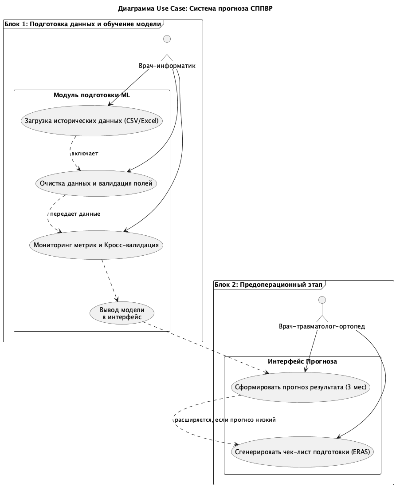
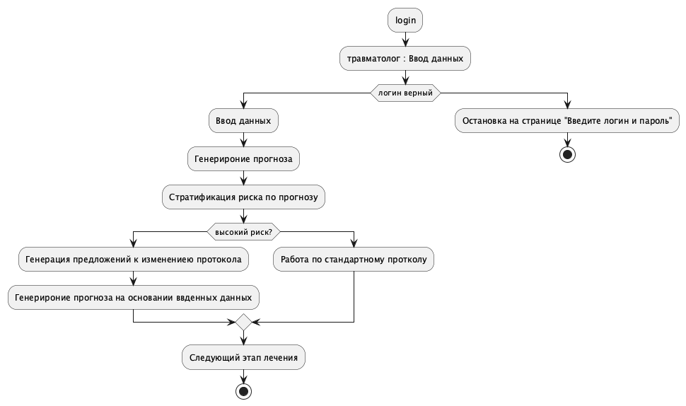
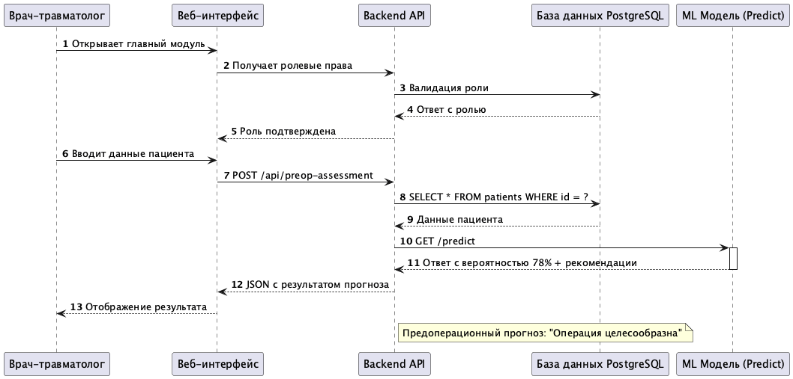
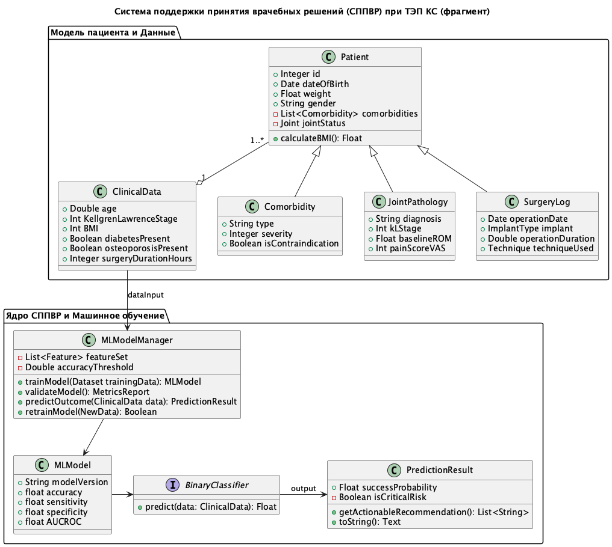

# 1. Спецификация требований к программе

**Название:** Система поддержки принятия врачебных решений (СППВР) при выполнениий первичного эндопротезирования коленного сустава. 

Программное решение (ПР), позволяющее вычислять на основе оптимальной модели сашинного обучения эффективность выполнения всего цикла лечения пациентов со стадией III-IV по Келлгрена — Лоуренса (Kellgren-Lawrence), которым назначено тотальное эндопротезирование коленного сустава в системе протокола ускоренного восстановления после операции (ERAS - Enhanced Recovery After Surgery).

Цель ПР - на основании рекомендательной СППВР улучшить результаты лечения поциентов, получающих первичное эндопротезирование коленного сустава  .

## Концепция программного решения:

ПР предназначено для врача травматолога-ортопеда, врача реабилитолога, врача терапевта, врача медицинского информатика. Система должна решать конкретную задачу бинарной классификации по конкретной первичной точки, а именно получение полного объема движений в коленном без болевого синдрома к 3 месяцам после опрации. Система решает актуальную научно практическую задачу сниженитя 15% доли недостижения первичной точки по данным литературы.

## Пользователи:

- врач
    - травматолог-ортопед
    - реабилитолог
    - терапевт
- медицинский информатик
- систеный администратор
- руководитель команды (НИР/НИОКР)

## Определение пользователей:
- **врача травматолог-ортопед** - врач принимающий окончательное решение в подборее тактики до опреации, выбора интраоперационых решений и ведение раннего послеоперационног периода на время госпитализации.
- **врач реабилитолог** - врач принимающий вспомогательные решения на догопитальном и внегоспистальном послеоперационнгом периоде.
- **врач терапевт** - врач принимающий вспомогательные решения о допуске на операцию, оценивающий сопуствующие риски и дополняющий рекомендации врача травматолога и .
- **врач медицинский информатик** - врач выполняющий создание протокола НИР/НИОКР, выполняющий непосредственную работу по соданию схемы данных, организовывающий сбору данных, проводящий ETL (Extract, Transform, Load — извлечение, преобразование, загрузка), проводящий раведовательный анализ данных, выполняющий подбор модели, ее поддержку, корректировку и вывод.
- **систеный администратор** - специалист, овечающий за координацию работы информационный сиситемы, поддержку работоспособности и опредление уровней доступа.
- **руководитель команды (НИР/НИОКР)** - руководитель проекта, выполняющий основную отчетность перед вышестоящей инстанцией (например отдел сопровождения научных исселедований)

## Пользовательские истории

### Блок 1: Подготовка данных и обучение модели

*История 1: Импортирование исторических данных пациента*

-   **Как:** Врач-информатик
-   **Хочет:** загружать массив клинических данных пациентов,
оперированных в прошлом (возраст, вес, стадия артроза, сопутствующие
заболевания, доп. операции),
-   **Чтобы:** подготовить «обучающую выборку» для машинного обучения
модели.
-   ***Реализация:**
    1.   Система корректно считывает CSV/Excel файлы с историей клиники.
    2.  Пропуск критически важных полей (например, наличие диабета или
инсультов) блокирует загрузку.
    3. Применение решений ускорения очистки данных.

*История 2: Проверка качества данных и разметка классов*

-   **Как:** Врач-информатик
-   **Хочет:** очищать базу от «шума» и проверять разметку результата,
-   **Чтобы:** модель машинного обучения обучалась на достоверных данных.
-   ***Реализация:**
    1. Система визуализирует выбросы (аномалии) в данных.
    2. проверяет принятые классификаторы


*История 3: Мониторинг точности модели и ее адаптация*

-   **Как:** Врач-медицинский информатик
-   **Хочет:** видеть текущие показатели точности (Площадь под кривой, Точность,Специфичность, Чувствительность, Отбалансированная точность) модели на валидационной выборке, а так проводить кросс валидацию
-   **Чтобы:** убедиться, что снижение доли недостижения цели происходит.
-   ***Реализация:**
    1.   На дашборде отображается метрика точности прогноза.
    2.   При снижении точности ниже порога система предупреждает о необходимости пересборки модели.
    3.   При снижении точности ниже порога, косле кросс валидации система предупреждает о необходимости пересборки модели.


### Блок 2: Предоперационный этап

*История 4: Прогнозирование результатов на основе СППВР*

- **Как:** Врач-травматолог-ортопед
-   **Хочет:** ввести данные пациента в
интерфейс перед операцией,
-   **Чтобы:** получить прогноз вероятности достижения целевого исхода (полный объем движений без боли к 3 мес).
-   **Реализация:**
    -   Система принимает ввод данных.
    -   Возвращает балл риска в виде вероятностной шкалы для .
    -   Отображает рекомендацию: «Операция целесообразна» / «Требуется
коррекция протокола».

*История 5: Корректировка протокола ERAS до операции*

-   **Как:** Врач-травматолог-ортопед
-   **Хочет:** получить список рекомендаций по подготовке пациента
(например, снижение веса, ЛФК до госпитализации), если система
прогнозирует низкую вероятность успеха,
-   **Чтобы:** повысить шансы на достижение первичной точки до 3 месяцев.
-   **Реализация:**
    -   При показателе вероятности > 15% негативного исхода система предлагает чек-лист действий
(например: «Рекомендуется консультация кардиолога», «Введение
антикоагулянтов»).
    -   Рекомендации обоснованы данными модели (связь с факторами риска).

---

## Блок 3: Внутренний операционный период

*История 6: Интраоперационная оценка рисков осложнений*

-   **Как:** Врач-травматолог-ортопед
-   **Хочет:** видеть влияние интраоперационных факторов (размер дефекта,
тип протеза, размер протеза, производитель протеза, длительность операции), введенных в СППВР в реальном времени,
-   **Чтобы:** оперативно оценить риск отказа.
-   **Реализация:**
    -   Интерфейс позволяет добавить/изменить параметры операции.
    -   Пересчитывается итоговый прогноз эффективности лечения.

---

## Блок 4: Послеперационный период

*История 7: План реабилитации на основе прогноза СППВР*

-   **Как:** Врач-реабилитолог
-   **Хочет:** получить персонализированный план реабилитации с учетом
предоперационного прогноза системы,
-   **Чтобы:** признать пациентов неблагопритного исхода с вероятностью > 15% и изменить программу тренировок или изменить медикаментозную поддержку.
-   **Реализация:**
    -   План генерируется автоматически на основе данных о пациенте.
    -   Если прогноз был низким, план включает стандартный протокол.

*История 8: Контроль прогресса через «точку контроля» (3 месяца)*

-   **Как:** Врач-реабилитолог
-   **Хочет:** отмечать достижение пациентами целевых показателей
(диапазон движений, отсутствие боли VAS) к 3 месяцам,
-   **Чтобы:** система фиксировала успех или неудачный исход и вносила данные для
обучения модели.
-   **Реализация:**
    -   Интерфейс содержит галочку «Цель достигнута / Не достигнута».
    -   Данные сохраняются в базу данных.


## Блок 5: Оценка рисков и допуск к операции


*История 9: Экспресс-оценка противопоказаний*

-   **Как:** Врач-терапевт
-   **Хочет:** оценивать влияние хронических болезней на прогноз СППВР до
направления пациента к травматологу,
-   **Чтобы:** отсеять пациентов с высоким общим риском и снизить процент
осложнений.
-   **Реализация:**
    -   Система показывает блок «Стратификация риска» с цветовым
кодированием (зеленый/желтый/красный).


---

## Блок 6: Администрирование и отчетность
**Пользователь:** Врач медицинского информатика (в части поддержки) +
Руководитель отдела НИОКР

*История 10: Генерация отчетности для протокола НИР/НИОКР*

-   **Как:** Врач-мед. информатик / Руководитель исседования
-   **Хочет:** выводить сводку по эффективности внедрения СППВР (сравнение
статистики «До» и «После» применения системы),
-   **Чтобы:** обосновать финансирование и научную ценность проекта
(снижение доли недостижения первичной точки).
-   **Hализация:** 
1. Готовый отчет (PDF/Excel) с таблицей динамики целевых показателей. 2) Возможность фильтрации по отделениям, типам протезов, возраста пациентов.

*История 11: Настройка модели для конкретных типов пациентов*

- **Кто:** Врач-мед. информатик
- **Хочет:** настраивать «веса» факторов в модели,
- **Чтобы:** адаптировать алгоритм под специфику конкретной клиники или
регионную базу данных.
- **Какая рализация:** В админ-панели доступна настройка чувствительности к факторам, а именно вывод метрик качества модели

*История 12: Настройка модели для конкретных типов пациентов*

- **Кто:** системный администратор
- **Хочет:** иметь возможность определенять права доступа, видеть системные ошибки работы архитектуры, котрые нельзя выводить в общее использование,
- **Чтобы:** поддерживать работоспособность и безопасность системы.
- **Какая рализация:** создание специальноего модуля приложения обеспечивающего удобное администрирование для работы с базами данных и содержимым системы.


# ФУНКЦИОНАЛЬНЫЕ ТРЕБОВАНИЯ (ФТ)
**Название:** Система поддержки принятия врачебных решений (СППВР) при
первичном эндопротезировании коленного сустава (ТЭП КС).

**Версия документа:** 1.0

**Цель:** Обеспечение бинарной классификации результата лечения
(успех/неудача к 3 месяцам) и предоставление персонализированных
рекомендаций для улучшения показателей ERAS.


```{=html}
<table border="1">
    <thead>
        <tr>
            <th>Группа требований</th>
            <th>Детализация требований</th>
        </tr>
    </thead>
    <tbody>
        <tr>
            <td><b>1. Требования к навигации и интерфейсу
пользователя</b></td>
            <td>
                <br>
                1.1 Создать главное меню, содержащее доступ к основным
модулям (Предоперационная оценка, Обучение модели, Интраоперационный
журнал, Постоперационное ведение, Отчеты).<br><br>
                1.2 Создавать варианты пользовательского представления
(Views) в зависимости от роли пользователя (Травматолог видит клинический
модуль, Информатик — модель и базу данных).<br><br>
                1.3 Обеспечить переходы по навигационным элементам без
перезагрузки страницы (Single Page Application подход) для удобства
использования в динамике операционного блока.
            </td>
        </tr>
        <tr>
            <td><b>2. Требования к безопасности и доступу</b></td>
            <td>
                2.1 Создать форму входа по логину и паролю (включая
восстановление пароля).<br><br>
                2.2 Проводить валидацию ролей при входе: идентифицировать
пользователя как врача-травматолога, реабилитолога, терапевта или
информатика.<br><br>
                2.3 Ограничивать доступ к чувствительным данным (например,
сырые данные ML модели) только для роли «Врач-мед. информатик».<br><br>
                2.4 Создать редактор настройки первой точки исследований
(определение целевого исхода: полный объем движений + отсутствие боли
VAS).<br><br>
                2.5 Создать редактор отчетов для формирования PDF/Excel
документов по итогам работы системы.<br><br>
                2.6 Создать редактор визуализации данных (выбор типа
графиков, гистограмм точности и чувствительности).
            </td>
        </tr>
        <tr>
            <td><b>3. Требования к управлению данными и
ML-моделированием</b></td>
            <td>
                3.1 Создать соединение с СУБД (PostgreSQL/MySQL) с
соответствующим уровнем доступа (Write для Инорматика, Read для
Врачей).<br><br>
                3.2 Создать возможность соединения с API существующей
системы управления больницей (HIS/PACS) для импорта истории болезни
пациента (ЭМК).<br><br>
                3.3 Реализовать модуль ETL: извлечение исторических
данных, преобразование их в формат датасета, загрузка на сервер модели.
            </td>
        </tr>
        <tr>
            <td><b>4. Управление обучением и валидацией модели (Блок
1)</b></td>
            <td>
                4.1 Загрузка обучающей выборки: Пользователь (Информатик)
должен загружать CSV/Excel файлы с историей операций (возраст, вес, стадия
КЛ, коморбидность).<br><br>
                4.2 Валидация критических полей: Система должна
блокировать загрузку или помечать строки как «Недопустимые», если
отсутствуют обязательные поля (например, наличие диабета, инсультов,
стадия КЛ), критичные для бинарной классификации.<br><br>
                4.3 Очистка данных: Система должна визуализировать выбросы
(аномалии) и пропущенные значения, предоставляя инструменты для их очистки
(сглаживание или удаление).<br><br>
                4.4 Маркировка классов: Система должна позволять
подтвердить разметку целевой переменной («100% результат» / «&lt;100%
результат») перед обучением.<br><br>
                4.5 Мониторинг качества модели: Интерфейс должен
отображать метрики на валидационной выборке (AUC-ROC, Accuracy, Precision,
Recall, F1-Score).<br><br>
                4.6 Алгоритм подсказок о выборе критерия: Система должна
подсказывать информатику о выборе признаков (Feature Importance), если они
слабо влияют на качество модели.<br><br>
                4.7 Валидация мощности выборки: Подсказывать об
достаточности данных для достижения статистической значимости (Power
Analysis) перед запуском обучения.
            </td>
        </tr>
        <tr>
            <td><b>5. Клинический функционал: Предоперационный
этап</b></td>
            <td>
5.1 Создать блок «Сопутствующие риски»
для врача-терапевта/травматолога с цветовым кодированием (Зеленый — низкий
риск, Желтый — умеренный, Красный — высокий).<br>5.2
Реализовать логику блокировки: При красном цвете и прогнозе отказа от
лечения > 80% система должна выдавать предупреждение и предлагать
перепроверить диагноз или отсрочить операцию.<br>5.3
Отображать влияние хронических заболеваний на прогноз СППВР до направления
пациента к травматологу.<br><br>
5.4Создать форму ввода клинических
данных пациента перед операцией (демография, стадия КЛ, исходные
риски).<br>5.5 Возвращать балл риска в виде
вероятностной шкалы (0–100% вероятность достижения цели: Full ROM + No
Pain к 3 мес).<br>5.6 Отображать рекомендацию СППВР:
«Операция целесообразна» / «Требуется коррекция протокола».<br><br>
5.7 Генерировать список рекомендаций по
подготовке, если вероятность успеха &lt; Порога (например, &lt;
15%).<br>5.8 Рекомендации должны быть обоснованы
факторами риска (связь с моделью): «Рекомендуется снижение веса»,
«Консультация кардиолога», «Введение антикоагулянтов», «Дополнительный
курс ЛФК».
            </td>
        </tr>
        <tr>
            <td><b>6. Клинический функционал: Внутренний операционный
период (Intra-op)</b></td>
            <td>
6.1 Создать интерфейс для ввода
интраоперационных факторов в СППВР (длительность операции, тип протеза,
размер дефекта кости, использование
аутрилинга).<br>6.2 Пересчитывать итоговый прогноз
эффективности лечения (Risk Score) динамически сразу после ввода каждого
нового фактора.<br>6.3 Визуализировать риск отказа от
реабилитации или раннего сращения в виде прогресс-бара или цветовой метки,
чтобы хирург мог оперативно скорректировать технику операции.
            </td>
        </tr>
        <tr>
            <td><b>7. Клинический функционал: Постоперационный период и
Реабилитация</b></td>
            <td>
7.1 Создать алгоритм генерации
персонализированного плана реабилитации на основе прогноза СППВР (до/после
операции).<br>7.2 При «низком прогнозе» из начальной
модели план должен включать обязательные процедуры усиления интенсивности
(Частота ЛФК, контроль ХГБ).<br>7.3 При «высоком
прогнозе» план может быть стандартизирован согласно протоколу ERAS
(базовый).<br>
7.4 Создать форму «Точки контроля
(Checkpoint)» для врача-реабилитолога к 3 месяцам после
операции.<br>7.5 Интерфейс должен содержать галочку
«Цель достигнута / Не достигнута».<br>7.6 Сохранение
данных об исходе в базу данных для дообучения модели (замыкание цикла
обучения).<br>7.7 Система должна автоматически
обновлять метрики обучения на основе введенных результатов (Retraining
Trigger).
            </td>
        </tr>
        <tr>
            <td><b>8. Требования к администрированию и отчетам</b></td>
            <td>
8.1 Настроить «веса» факторов в
модели в админ-панели для адаптации алгоритма под специфику конкретной
клиники или региона.<br>8.2 Проводить кросс-валидацию
и отображать метрики качества (AUC) при пересборке модели.<br>
8.3 Вывод сводки по эффективности
внедрения СППВР (сравнение статистики «До» и «После» применения
системы).<br>
8.4 Фильтрация отчетов по отделениям,
типам протезов, возрасту пациентов, году проведения
лечения.<br>8.5 Экспорт данных в форматы PDF или Excel
с таблицей динамики целевых показателей.
            </td>
        </tr>
        <tr>
            <td><b>9. Нефункциональные требования к функциям</b></td>
            <td>
                9.1 Доступность: Система должна обеспечивать доступность
для врачей-клиницистов на планшете/мобильном устройстве в операционной или
кабинете реабилитации.<br><br>
                9.2 Производительность: Время расчета прогноза СППВР
должно составлять не более 10 секунд после загрузки данных
пациента.<br><br>
                9.3 Аудит: Система должна вести журнал
аудита (Audit Log): кто, когда и что изменил в конфигурации модели или
записал результат исхода лечения.
            </td>
        </tr>
    </tbody>
</table>

```

## 2. Проектирование алгоритма решения задачи согласно процедурной парадигме

**Модель прецедентов(фрагмент)**




**Диаграмма деятельности(фрагмент)**



**Диаграмма последовательн(фрагмент)**




## 4. Проектирование объектной модели

**Цель** - выяснить принципы разработки диаграмм взаимодействия (в частности
последовательностей), соответствующие потокам событий вариантов
использования.

**Диагнрамма классов**




